# Hi, I'm Sayan Bhattacharya 👋

**Founder @ DialMate AI • Communications & Signal Processing MSc (TU Ilmenau)**  
*Building Autonomous Multi-Agent Workflows, Audio DSP & Speech Intelligence, and Machine Prognostics.*

---

### 🔬 Core Engineering & Research Pillars

```mermaid
graph TD
    classDef ai fill:#eff6ff,stroke:#1e40af,stroke-width:2px;
    classDef dsp fill:#f0fdf4,stroke:#15803d,stroke-width:2px;
    classDef pdm fill:#fefce8,stroke:#a16207,stroke-width:2px;
    classDef app fill:#fdf2f8,stroke:#be185d,stroke-width:2px;

    subgraph Agentic_AI ["🤖 Autonomous Multi-Agent & RAG Systems"]
        A1[Multi-Agent Orchestration<br/>LangGraph + Pydantic AI] --> A2[Autonomous Planning & Routing]
        A2 --> A3[Local LLM Inference<br/>LLaMA-2 / Ollama / Transformers]
    end

    subgraph Signal_DSP ["🎧 Audio DSP & Speech Intelligence"]
        B1[Psychoacoustic Modeling<br/>ISO/IEC 11172] --> B2[Time-Frequency Transforms<br/>MDCT & Polyphase Filter Banks]
        B2 --> B3[Speech Emotion Telemetry & Analytics]
    end

    subgraph Prognostics ["⚙️ Machine Prognostics & Edge PdM"]
        C1[High-Frequency Sensor Data<br/>PRONOSTIA & IMMS Fan Datasets] --> C2[Autonomous Feature Ranking Benchmark]
        C2 --> C3[Embedded Resource-Constrained RUL Estimation]
    end

    subgraph Systems ["🚀 Enterprise Full-Stack & Delivery"]
        D1[Modern Reactive Frontend<br/>React 18 / Vite / Remotion] --> D2[Scalable Backend Services<br/>Node.js / Express / Flask]
        D2 --> D3[Automated Production Pipelines & CI/CD]
    end

    class A1,A2,A3 ai;
    class B1,B2,B3 dsp;
    class C1,C2,C3 pdm;
    class D1,D2,D3 app;
```

---

### 📊 GitHub Activity & Metrics

 

---

### 🌟 Featured Repositories & Engineering Highlights

| Repository | Focus & Architecture | Visual Highlights |
| :--- | :--- | :--- |
| **[Dialmate](https://github.com/sayan-bhattacharya/Dialmate)** | **Emotional Intelligence & Voice Analytics Dashboard** Full-stack conversation analytics platform integrating local LLaMA-2 inference, speech emotion telemetry, Flask REST gateway, and a responsive React monitoring dashboard. | Multi-tier pipeline diagram, local LLM inference guide, real-time emotion tracker. |
| **[AgentRAGroute](https://github.com/sayan-bhattacharya/AgentRAGroute)** | **Autonomous Multi-Agent Meta-Builder** LangGraph + Pydantic AI orchestration engine with reasoning models (o3-mini/R1), dynamic vector documentation retrieval, and type-safe agent code synthesis. | LangGraph state graph routing flow, Supabase vector retrieval, modular agent generation. |
| **[Masters-Thesis-MA-](https://github.com/sayan-bhattacharya/Masters-Thesis-MA-)** | **Autonomous Feature Ranking for Machine Prognostics** TU Ilmenau M.Sc. thesis research benchmarking feature selection algorithms for predictive maintenance (PdM) on resource-constrained embedded systems (PRONOSTIA & IMMS datasets). | Complete feature ranking & RUL estimation architecture, mathematical formulation, embedded trade-off metrics. |
| **[Audio-Coding](https://github.com/sayan-bhattacharya/Audio-Coding)** | **Advanced Audio Coding & Psychoacoustic DSP** Graduate-level digital signal processing seminars covering MDCT, polyphase filter banks, psychoacoustic masking thresholds, and non-uniform bit allocation. | End-to-end audio encoder pipeline diagram, seminar task breakdowns, DSP math models. |
| **[Airborne-Laser-Scannning](https://github.com/sayan-bhattacharya/Airborne-Laser-Scannning)** | **Forest Pulse LiDAR Analysis & 3D Point Cloud Processing** Python + PDAL geospatial pipeline for filtering, canopy height model (CHM) extraction, stand boundary clipping, and 3D vegetative point cloud visualization. | LiDAR point cloud classification flow, embedded 2D/3D visualization plots. |
| **[sport-bulletinapp](https://github.com/sayan-bhattacharya/sport-bulletinapp)** | **Score Adda — Real-Time Sports Bulletin & Video Reel Engine** Vite + React + Remotion automated video brief generator and live match tracker with GitHub Pages and Hostinger deployment. | Live demo preview, Remotion programmatic video pipeline, modern motion UI. |

---

### 🛠️ Technology Stack & Toolkit

**AI / ML & Multi-Agent**  
`Python` • `PyTorch` • `LangGraph` • `Pydantic AI` • `Transformers` • `Scikit-learn` • `Ollama` • `Supabase Vector`

**Signal Processing & Scientific Computing**  
`Audio DSP` • `MDCT & Filter Banks` • `Psychoacoustics` • `NumPy` • `SciPy` • `PDAL & Laspy` • `Matplotlib / Seaborn`

**Full-Stack & Systems**  
`TypeScript` • `React 18` • `Node.js` • `Express` • `Flask` • `FastAPI` • `Tailwind CSS` • `PostgreSQL` • `MongoDB` • `Docker`

---

### 📬 Connect & Collaborate

- **Location**: Ilmenau, Germany / Kolkata, India
- **Email**: [sayanpm17@gmail.com](mailto:sayanpm17@gmail.com)
- **LinkedIn**: [linkedin.com/in/snbhattacharya5](https://www.linkedin.com/in/snbhattacharya5/)
- **DialMate AI**: [dialmateai.com](https://dialmateai.com)
